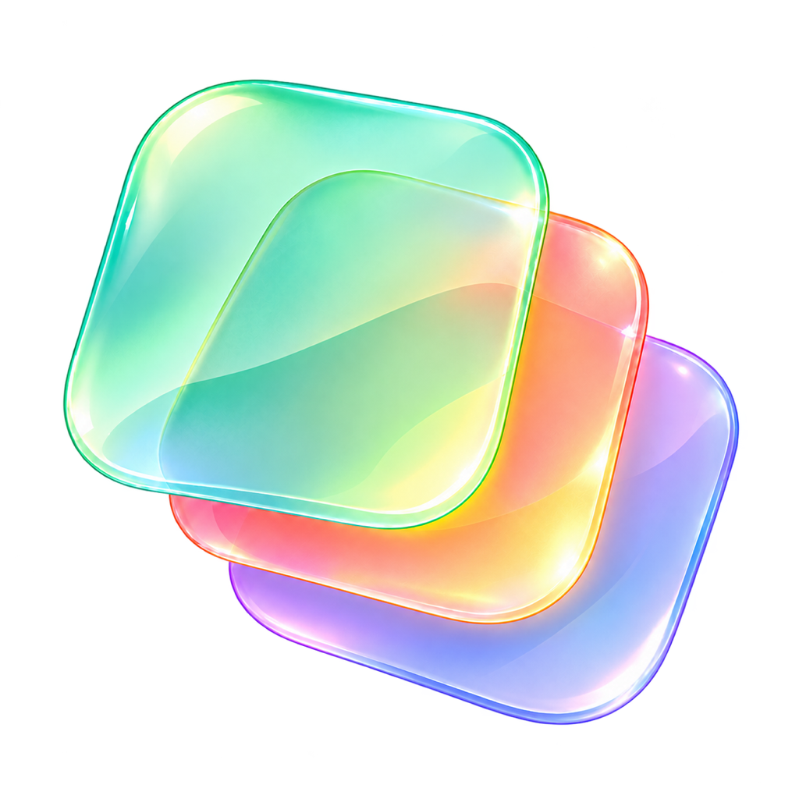

# 叠绘 / Compositor



**为 Compositor 做中文版，并持续修复、完善图像编辑体验。**

本项目基于 **[Robbie Tilton](https://github.com/robbietilton)** 的 **[Compositor](https://github.com/robbietilton/Compositor)**，参考和借鉴 **[Terry Jia / jtydhr88](https://github.com/jtydhr88)** 的 **[Pentrado](https://github.com/jtydhr88/pentrado)**。感谢两位作者及各自项目的贡献者开放源码，让中文本地化与后续完善成为可能。

这是社区维护的中文完善版。macOS 版在 Compositor 原生代码上进行本地化和功能完善；Windows 版使用 Pentrado 的合成引擎，重新实现桌面界面、编辑操作及 `.comp` 项目读写。Pentrado 也为对齐/分布、对称绘画和编辑操作设计提供参考。我们希望改进成果也能帮助原项目。

**Chinese localization and ongoing improvements for Compositor.**

The macOS edition localizes and extends **[Compositor](https://github.com/robbietilton/Compositor)** by **[Robbie Tilton](https://github.com/robbietilton)**. The Windows edition uses the compositing engine from **[Pentrado](https://github.com/jtydhr88/pentrado)** by **[Terry Jia / jtydhr88](https://github.com/jtydhr88)**, with a new desktop interface, editing operations and `.comp` project bridge. Pentrado also informs arrangement, symmetry and editing design. Thank you to both authors and their contributors for sharing their work. This community edition focuses on Chinese localization, fixes and practical improvements, with the hope that useful changes can benefit the upstream projects too.

## macOS 与 Windows 的区别 / macOS and Windows differences

两版面向图层绘画与图像编辑，采用不同的界面、渲染及编辑实现。下表说明当前版本的实际差异。

Both editions support painting and image editing with layers, with different UI, rendering and editing implementations. The table describes the current versions.

| 项目 / Area | macOS | Windows |
| --- | --- | --- |
| 技术路线 / Stack | Swift + SwiftUI / AppKit，部分像素算法使用 C；在 Compositor 原生代码上完善。 / Extends Compositor's native Swift app, with SwiftUI/AppKit and some C pixel algorithms. | TypeScript / JavaScript + Vue 3 + Electron；自行实现界面、编辑事务及项目桥接。 / A new Vue/Electron desktop interface, editing transactions and project bridge. |
| 渲染 / Rendering | Metal + Core Image + Core Graphics，使用系统图像与 GPU 接口。 / Uses Apple's image and GPU APIs. | Pentrado WebGL2 合成引擎；Canvas 2D 绘制文字/形状，工作线程执行像素处理。 / Pentrado WebGL2 compositing, Canvas 2D text/shapes and pixel processing in workers. |
| 文字编辑 / Text editing | 画布内原生文字编辑，使用 AppKit 文本系统。 / Native inline editing on the canvas with AppKit. | 在文字编辑面板中输入和设置样式，以 Canvas 2D 排版并生成像素。 / Text and styles are edited in a panel, then laid out and rasterized with Canvas 2D. |
| 背景移除 / Background removal | Apple Vision 主体识别，结果保存为可调整的图层蒙版。 / Apple Vision subject recognition produces an editable layer mask. | 从图像边缘按颜色容差清除相近背景像素，适合较简单背景。 / Clears similar background pixels from the edges using color tolerance; suited to simpler backgrounds. |
| 图层锁定与对称 / Locks and symmetry | 内容/位置/外观/透明度会话锁；尚无对称画笔。 / Session locks for content, position, appearance and alpha; no symmetric brush yet. | 内容/位置/外观/透明度会话锁；双轴及 2–16 份径向对称绘画。 / Session locks for content, position, appearance and alpha; symmetry across both axes and radial symmetry with 2–16 sectors. |
| 语言切换 / Language switching | 保存语言选择后重启生效。 / The saved language choice takes effect after restarting. | 简体中文 / English 即时切换，选择保留到下次启动。 / Chinese/English switching is immediate and persists. |
| 安装包 / Packages | `.app` 压缩包。 / A ZIP containing the app. | EXE 安装向导或便携 ZIP。 / An EXE installer or portable ZIP. |

**项目兼容性：**macOS 1.4.8（40.24）读取 `.comp` v1–16；普通项目保存为 v13，可编辑滤镜或持久液化使用 v14，新通道半调配方使用 v15，动画项目使用 v16。已发布的 Windows 0.3.0 安装包创建 v11 项目并保留读取到的 v12/v13 元数据，不支持 v14–16；交换此类项目时需导出 PSD/图像，或在副本上栅格化并移除动画后保存为 v13。Windows 源码已增加动画和 EPS/GIF 支持，尚未包含在 0.3.0 安装包中。交换项目时需复制整个 `.comp` 文件夹。两套渲染器及系统字体可能产生不同的文字排版、滤镜或效果结果；Windows 的画质基准定标仍待完成。Windows 遇到不能准确编辑的可见属性时，会明确使用项目保存的预览并限制编辑，同时保留未知字段和未改动资源。功能同名也可能采用不同算法，具体使用范围见各版说明。安装包均可直接使用，无需编译或安装开发工具。

**Project compatibility:** macOS 1.4.8 (40.24) reads `.comp` v1–16: ordinary saves use v13, editable filters and saved Liquify use v14, channel-screen halftone recipes use v15, and animation uses v16. The published Windows 0.3.0 package creates v11 projects and preserves v12/v13 metadata; it cannot open v14–16. Exchange rendered PSD/images, or explicitly bake a copy and remove its animation before saving v13. Animation and EPS/GIF support have been added to Windows source but are not in the 0.3.0 package. Transfer the entire project folder. Different renderers and system fonts can produce different text layouts, filter results and effects; Windows image-quality calibration remains pending. When Windows cannot accurately edit a visible property, it explicitly uses the saved preview and restricts editing while preserving unknown fields and unchanged resources. Similarly named features can use different algorithms; consult each edition's documentation. Downloaded packages run directly without compilation or developer tools.

## 下载与使用 / Download and use

**[macOS 1.4.8（40.24）](https://github.com/Pengjingyu1992/Compositor-ZH/releases/tag/v1.4.8-zh.4)** 新增完整动画 GIF、像素 EPS 导入/导出及紧凑毛玻璃新建画布界面。普通 EPS 导入需单独安装 Ghostscript。范围、入口及安装方法见 [EPS/GIF 说明](docs/eps-gif.md)。Windows 0.3.0 安装包尚未包含这些新增格式。 / **[macOS 1.4.8 (40.24)](https://github.com/Pengjingyu1992/Compositor-ZH/releases/tag/v1.4.8-zh.4)** adds animated GIF, raster EPS import/export and a compact glass-style New Canvas interface. General EPS import requires a separate Ghostscript installation. See the [format guide](docs/eps-gif.md). These new formats are not included in the Windows 0.3.0 package.

### Windows 10 / 11

- **[Windows 下载 / Windows downloads](https://github.com/Pengjingyu1992/Compositor-ZH/releases/tag/windows-v0.3.0-alpha.1)** · **[安装说明 / Installation guide](docs/windows-install.md)** · **[工具与快捷键 / Tools and shortcuts](docs/windows-full-editor.md)**
- Windows 10 22H2 / Windows 11，x64。0.3.0 编辑器提供 17 类工具：选区、裁剪、中文文字、可编辑形状、绘画/蒙版、渐变/油漆桶、仿制/修复/涂抹、取色与导航；另有多层变换、对齐/分布、编组/合并、21 项滤镜、调整/效果、剪贴板、撤销、保存、恢复和 PSD/PNG 转换，中英文即时切换。 / Windows 10 22H2 / Windows 11, x64. The 0.3.0 editor provides 17 tools for selections, crop, Chinese text, editable shapes, painting/masks, gradients/fill, clone/healing/smear, eyedropper and navigation, plus multi-layer transforms, arrangement, groups/merge, 21 filters, adjustments/effects, clipboard, undo, saving, recovery, PSD/PNG conversion, and Chinese/English switching.
- 基于 Pentrado 引擎，提供 EXE 安装包和便携 ZIP；编辑器无需 Node.js 或 API Key，可选 AI 助手需配置你自己的密钥。 / Built with the Pentrado engine; available as an EXE installer or portable ZIP. The editor needs no Node.js or API key; the optional AI assistant uses your own key.

### macOS

- [下载最新版本 / Download the latest release](https://github.com/Pengjingyu1992/Compositor-ZH/releases/latest)
- **macOS 26 或更高版本，Apple Silicon。 / macOS 26 or later, Apple silicon.**
- 解压后将 `Compositor.app` 拖到“应用程序”目录。 / Unzip and drag `Compositor.app` into Applications.
- 安装包直接使用，无需编译或安装开发工具。 / Use the downloaded app directly; no compilation or developer tools are needed.
- **叠绘 → 设置… → 界面语言**：选择简体中文或 English，保存项目后退出并重新打开应用。选择会保留；中文应用名为“叠绘”，英文为“Compositor”。
- **Compositor → Settings… → Interface language**: choose Simplified Chinese or English, save your work, then quit and reopen. Your choice persists.

当前安装包采用临时签名，未经 Apple Developer ID 公证；macOS 可能要求在“隐私与安全性”中确认打开。 / The current package is ad hoc signed and is not Apple notarized; macOS may require approval in Privacy & Security.

## macOS 版改进 / Changes in the macOS edition

| 功能 / Feature | 说明 / Notes |
| --- | --- |
| 中文与英文 / Chinese and English | 界面、菜单、提示、撤销名称与语言设置；下次启动切换。 / Localized UI, menus, alerts, undo names, and a persistent language setting applied on restart. |
| 自定义快捷键 / Custom shortcuts | 编辑菜单配置；修复中文标点、图层焦点与提示同步。详见 [修复与验证记录](docs/macos-shortcut-fixes.md)。 / Configure keys in Edit; fixes cover Chinese punctuation, layer focus and live shortcut labels. |
| 新建画布 / New Canvas | 紧凑毛玻璃面板、尺寸预设、实时比例预览、宽高互换及单一单位下拉按钮。 / Compact glass panel, size presets, live aspect preview, dimension swapping and one unit dropdown. |
| GIF / EPS | 动画 GIF 的帧、时长、循环与编辑/导出；EPS 栅格导入和扁平 RGB 导出，普通 EPS 导入需独立 Ghostscript。详见 [格式说明](docs/eps-gif.md)。 / Animated GIF frames, timing, loops, editing and export; raster EPS import and flattened RGB export, with separate Ghostscript required for general EPS import. See the [format guide](docs/eps-gif.md). |
| 对齐与分布 / Align and distribute | 6 种对齐、4 种分布；参照选中对象、画布或关键图层。 / Six alignment and four distribution operations, relative to the selection, canvas, or a key layer. |
| 油漆桶 / Paint bucket | `K`；颜色容差、连续区域及采样全部图层，结合当前选区。 / `K`; tolerance, contiguous filling, sample-all-layers, and current-selection coverage. |
| 马赛克 / Mosaic | 1–512 像素色块，支持预览、透明度、选区及撤销。 / 1–512 px blocks, preview, transparency, selections, and undo. |
| 本地恢复副本 / Local recovery | 空闲 2 秒或连续编辑最长等待 10 秒安排检查点，复用未变图像；恢复为独立未保存草稿。 / Checkpoints after 2 seconds idle or at most 10 seconds of continuous edits, reusing unchanged images; restored as separate unsaved drafts. |
| PSD 导出 / PSD export | 普通横排文字、单色路径、支持的填充/调整/效果可编辑；同时保留像素、组、混合及蒙版。 / Editable supported text, paths, fills, adjustments and effects, alongside pixels, groups, blending and masks. |
| 钢笔与路径 / Pen and paths | 锚点/控制柄、开闭路径、填充/描边、文字转轮廓、沿路径文字、弧形文字和矢量蒙版。 / Anchors/handles, open/closed paths, fill/stroke, text outlines, text on a path, arc text and vector masks. |
| 1.4.8 上游更新 / Upstream updates | RAW 与半透明效果修复、命令搜索、重复滤镜、画布全屏、导航器、增强扫描线、打印单位、WebP 导入和自定义裁剪。 / RAW and translucent-effect fixes, command search, last-filter repeat, canvas-only view, Navigator, enhanced Scanlines, print units, WebP import and custom crop ratios. |
| 导出与印刷预览 / Export and print preview | PNG/JPEG/PDF 尺寸预览、CMYK 转换预览、ICC 配置及 CMYK TIFF 导出；文档保持 RGB。详见 [使用说明](docs/macos-upstream-1.4.8.md)。 / Sized PNG/JPEG/PDF previews, CMYK conversion proofing, ICC profiles and CMYK TIFF output; documents remain RGB. See the [guide](docs/macos-upstream-1.4.8.md). |
| 稳定性 / Reliability | 编辑许可与异步提交检查；修复尺寸调整时效果丢失等问题。 / Edit permissions, guarded asynchronous commits, and fixes including effects preservation during resizing. |
| 新图标 / New icon | 薄荷绿、珊瑚粉、柔黄与淡紫的叠层图标。 / A layered icon in mint, coral, soft yellow, and lavender. |
| 海报与照片编辑 / Poster and photo editing | 可编辑填充和图层叠加样式、手动修边、彩色半调、中文竖排、可选颜色、通道混合器、`.cube` LUT、多尺寸导出，以及 CLI/MCP 批量命令。详见 [使用说明](docs/macos-poster-batch.md)。 / Editable fills and layer overlays, manual edge refinement, color halftone, vertical Chinese text, selective color, channel mixer, `.cube` LUTs, multi-size export, and CLI/MCP batch commands. See the [feature guide](docs/macos-poster-batch.md). |
| 基础滤镜栈 / Basic filter stack | 普通像素层保留原图，支持模糊、杂色、彩色半调及 LUT 的排序、启停、参数与选区范围；保存后可再编辑。 / Keep a pixel layer's source and re-edit blur, noise, color halftone and LUT steps, including order, enablement, settings and captured selections. |
| 持久液化 / Saved Liquify | 保存位移、冻结区域及画笔参数，重开后可继续修改；复用现有高级液化。详见 [两项功能说明](docs/macos-editable-filters.md)。 / Reopen saved displacement, frozen areas and brush settings in the existing Advanced Liquify workspace; see the [guide](docs/macos-editable-filters.md). |

macOS 版的基础图层、蒙版、画笔、文字、形状、选区、调整层、Camera Raw、PSD 导入及多项目标签等能力来自 Compositor。

The macOS edition's core layers, masks, brushes, text, shapes, selections, adjustments, Camera Raw, PSD import and project tabs come from Compositor.

### 当前边界 / Current limits

- PSD 保留普通横排文字、单色路径、支持的填充、调整及效果参数；其他内容转换为像素或要求合成导出，跨软件重新渲染可能不同。详见 [PSD 导出说明](docs/psd-export.md)。 / PSD retains supported text, paths, fills, adjustments and effects; other content uses pixels or flattened export. Rerendering can differ between editors.
- 恢复副本空闲 2 秒或连续编辑最长等待 10 秒安排写入，另需编码和写盘时间；最后的改动及未提交草稿可能尚未落盘。详见 [恢复说明](docs/recovery.md)。 / Recovery schedules writes after 2 seconds idle or at most 10 seconds of continuous editing, plus encoding and disk time; recent edits and uncommitted drafts may not have reached disk.
- 更新菜单打开本仓库的下载页，手动安装新版本。 / The update command opens this edition's releases for manual installation.
- 可编辑路径、文字轮廓、沿路径文字及矢量蒙版已加入，使用范围见 [路径说明](docs/macos-paths-batch.md)。 / Editable paths, text outlines, text on a path and vector masks are supported; see the [path guide](docs/macos-paths-batch.md).

## 构建 / Build

Windows 构建与云端验证见 [Windows 安装和开发说明](docs/windows-install.md)。macOS 构建保持以下流程。 / For Windows builds and cloud checks, see [Windows installation and development](docs/windows-install.md).

### Command Line Tools

使用带 macOS 26 SDK 的 Command Line Tools，可独立构建完整应用。macOS 27 的独立 CLT SDK 可能缺少 SwiftUI 宏插件，脚本优先选择已安装的 macOS 26 SDK；可用 `COMPOSITOR_SDK_PATH` 指定 SDK。

Command Line Tools with a macOS 26 SDK can build the app. The standalone macOS 27 SDK may lack SwiftUI macro plugins, so the script prefers an installed macOS 26 SDK. Override it with `COMPOSITOR_SDK_PATH` if needed.

```sh
./scripts/check-localization.zsh
./scripts/build-clt.zsh
./scripts/package.zsh
```

输出：`build/clt/Compositor.app`、`dist/` 中的 ZIP 和 SHA-256。 / Outputs: `build/clt/Compositor.app`, plus a ZIP and SHA-256 checksum in `dist/`.

## 来源、致谢与许可 / Credits and license

- **Compositor — Robbie Tilton / Wonder Assembly LLC**: the upstream native editor and most of this codebase. **MIT**, with the original copyright and license retained in [LICENSE](LICENSE).
- **Pentrado — Terry Jia / jtydhr88**: editing architecture and feature references, plus alignment/distribution geometry adapted to Swift. **MIT** notice retained in [Pentrado-LICENSE.txt](Compositor/Resources/Pentrado-LICENSE.txt).
- 本仓库的中文本地化及改动同样以 MIT 许可发布。 / Localization and modifications in this repository are also released under MIT.

详见 [第三方说明 / Third-party notices](THIRD_PARTY_NOTICES.md)、[源码来源 / Source provenance](UPSTREAM.md) 与 [发布审查 / Release review](docs/release-audit.md)。

macOS 海报与照片编辑扩展、CLI/MCP 安装和使用范围见 [使用说明](docs/macos-poster-batch.md)。

可编辑滤镜与液化重新编辑 / Editable filters and saved Liquify: [使用说明 / Guide](docs/macos-editable-filters.md).

圆形半调与灰度副本 / Round halftone screens and grayscale copies: [40.22 使用说明 / Guide](docs/macos-halftone-grayscale.md). 完整颜色模式和高位深仍在[后续方案 / Future plan](docs/macos-color-engine-plan.md)中。
