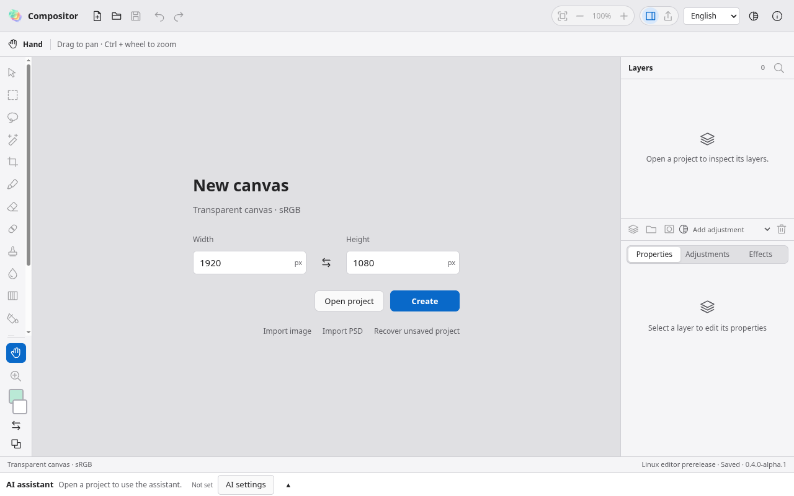
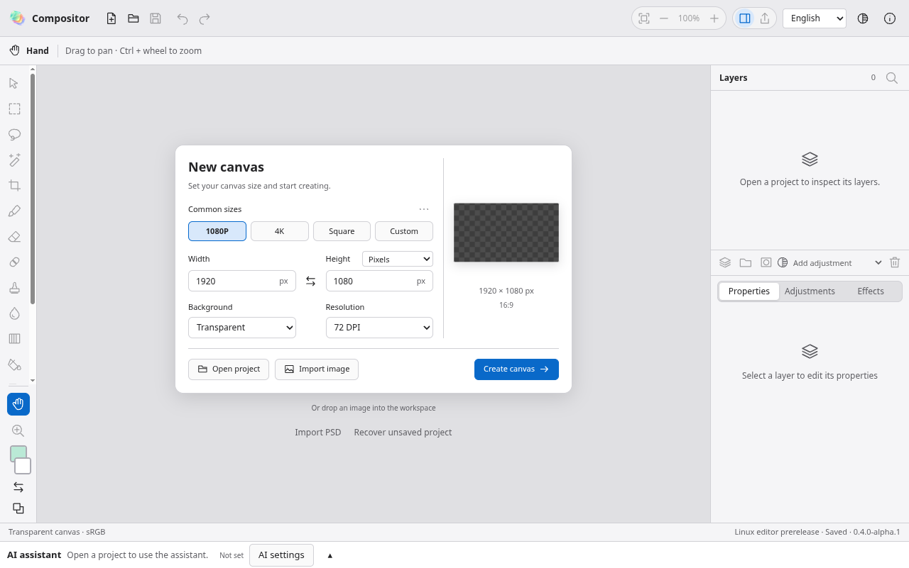
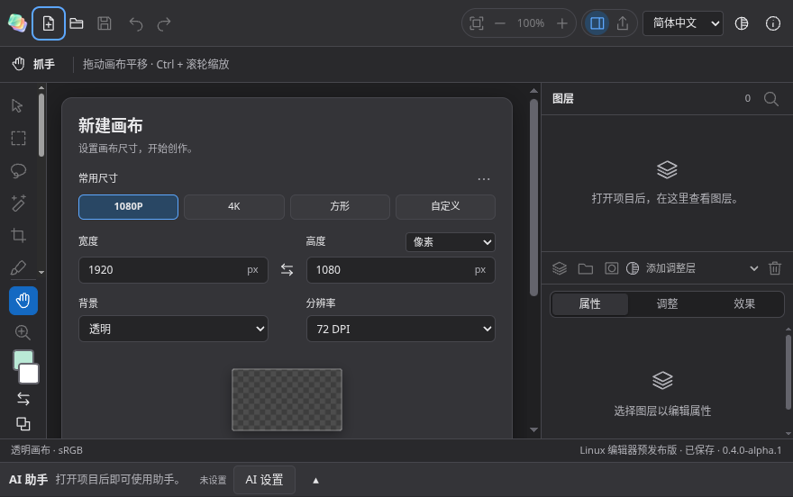
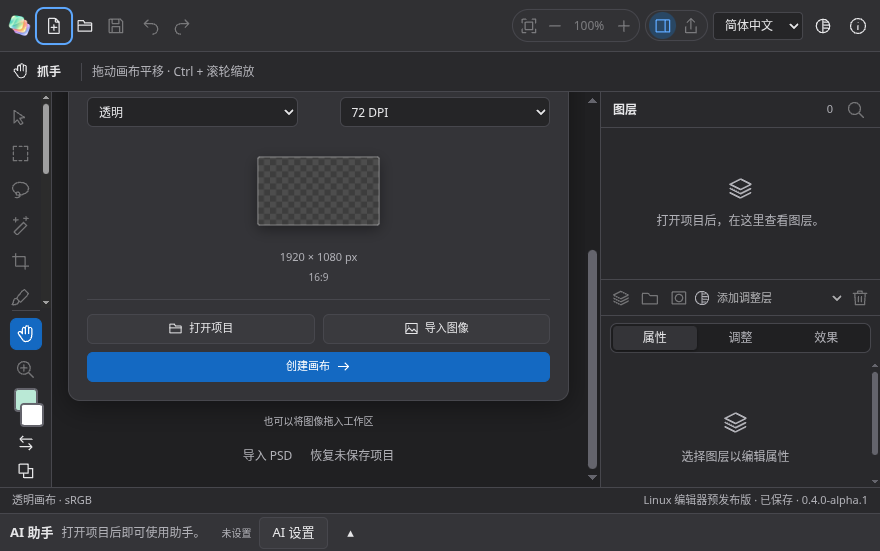
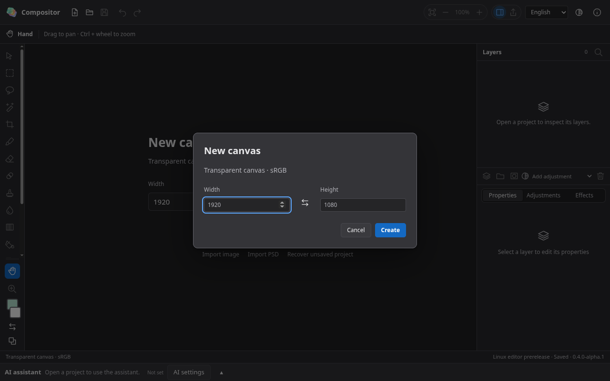
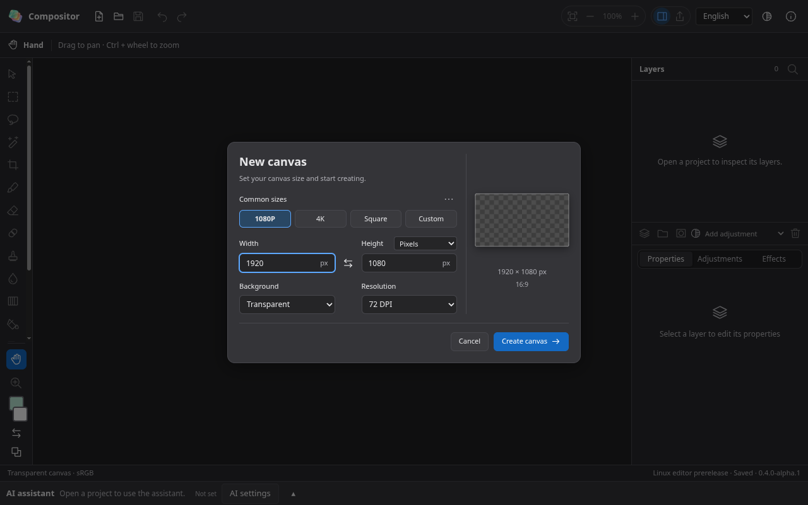
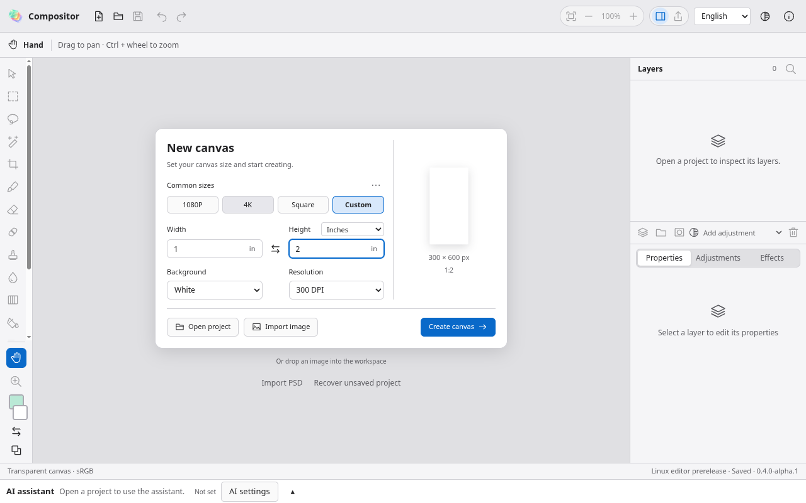
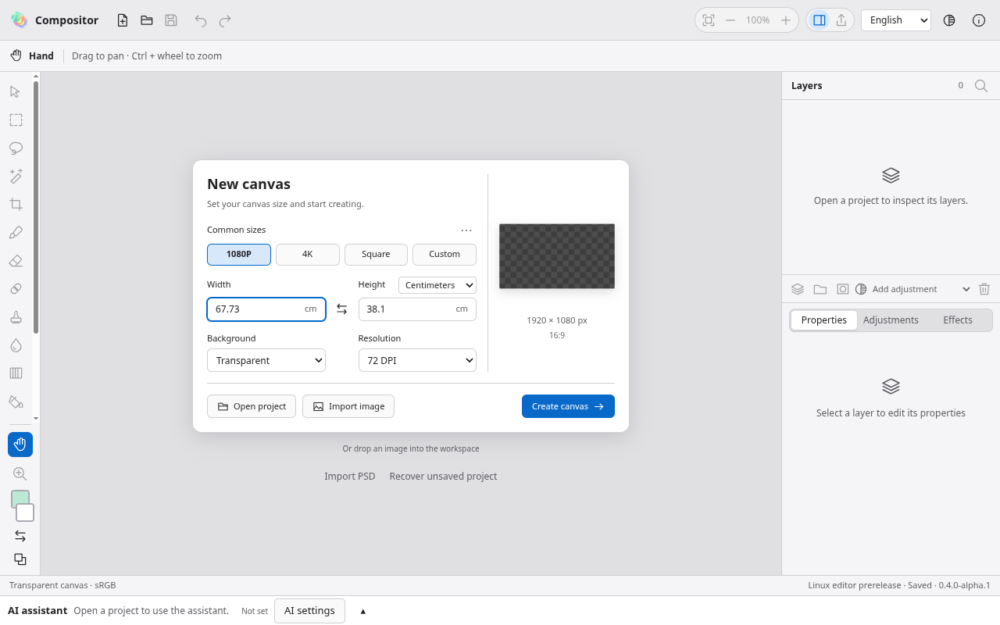

# Windows / Linux 新建画布界面对齐

应用与测试提交：`b674ae5`；基线：`d980310`；开发分支：`codex/desktop-macos-parity`。日期：2026-10-29。

原界面只有宽高和创建按钮，确实遗漏了 macOS 的整套新建画布卡片。本轮直接对照 `main` 上 macOS 40.41 的 [NewCanvasSheet.swift](https://github.com/Pengjingyu1992/Compositor-ZH/blob/f8b1457435c414a666db2e22d7f051ce19833a77/Compositor/UI/NewCanvasSheet.swift) 与本轮实际 Electron 截图，补齐布局和对应创建能力。原生 Mac 文件未修改。

## 检查步骤与结果

| 步骤 | 修改 | 验证 |
|---|---|---|
| 1 · 欢迎页 | 最大 560 px 的中性卡片、18 px 内边距、12 px 圆角；左侧设置、右侧画布预览；窄工作区纵向排列并可滚动到底部创建 | 中英文、浅深色、1280×800 与 880×540 通过；真实鼠标滚动可以到达创建按钮 |
| 2 · 新建弹窗 | 与欢迎页共用尺寸、预设、背景、DPI 和预览组件；保持取消／创建操作，首次焦点在宽度 | 通过：互换宽高、Enter 创建、Escape 关闭；取消替换后保留输入草稿与原项目 |
| 3 · 创建选项 | 1080P、4K、方形和自定义；更多菜单包含 Mac 同样的 12 个屏幕／设备／社交格式；四种单位、72／300 DPI、透明／白／黑背景和比例预览 | 通过：单位切换保留整数像素，打印单位随 DPI 换算；白／黑实际 RGBA 像素、保存后的 DPI、新标签页默认值和原标签内容均验证 |
| 4 · 剪贴板与边界 | 新建界面可用剪贴板 PNG 图像尺寸建议；只把宽高返回界面；异步结果不覆盖已手动输入的尺寸 | 通过：真实 ClipboardItem 图像、混合文字类型不读取、延迟响应与异常尺寸；前后端均拒绝超限创建 |

单位包括像素、英寸、厘米、毫米。每次打开新建弹窗均从像素、72 DPI、透明背景开始，避免把之前的打印单位带进新的默认画布；有效的剪贴板图像可以提供尺寸建议。原有导入 PSD、恢复未保存项目入口保留在欢迎卡片下方。

共享版沿用渲染器和编解码器的 **1,600 万像素**表面上限及 **30,000 px** 单边上限，界面明确提示超限；Mac 原生的较大内存预算未移植。本轮没有提高底层分配上限。透明画布保持共享版原有的空图层行为；白／黑背景生成可编辑背景像素层，DPI 随项目保存，不增加一个多余的撤销步骤。

## 本轮实际截图

均来自 Linux 的真实应用和隔离测试配置；Mac 对照以固定源码为依据，Windows 使用原生云端执行。截图及构建来源可见 [evidence.json](desktop-new-canvas-2026-10-29/evidence.json)。

### 1 · 欢迎页

修改前：

修改后：

中文窄工作区：

滚动到底部可以正常创建：

[中文窄窗口修改前](desktop-new-canvas-2026-10-29/welcome-compact-before.png)。

### 2 · 新建弹窗

修改前：

修改后：

[中文弹窗修改前](desktop-new-canvas-2026-10-29/dialog-compact-before.png) · [中文弹窗修改后](desktop-new-canvas-2026-10-29/dialog-compact-after.png)。

### 3 · 实际创建选项

英寸、300 DPI、白色背景：

测试实际创建并保存为 300×600 像素、300 DPI 的白色画布，读取项目清单和 PNG，确认尺寸、分辨率及像素；另在新标签创建黑色画布，并切回原标签确认内容保留。默认值重置、黑白不透明背景及透明空画布另有单元覆盖。

英文单位文本也作了单独复看，修复了 Centimeters 被原有下拉框宽度截短的问题，并为下拉指示箭头预留空间：

### 4 · 剪贴板、隐私与错误保护

Electron 44 使用 ClipboardItem API。新建尺寸建议调用 `clipboard.read()`，仅对 PNG 类型取得 Blob，再取前 **33 字节**读取图像头；不请求文字类型，不将图像或文字内容发往渲染进程、不记录建议来源、不持久化原剪贴板内容、不调用网络。没有 PNG 或无法访问时保留普通默认尺寸。此处未实现 TIFF 尺寸建议。

输入超限时创建按钮禁用；主进程还会独立检查，防止绕过界面造成超大分配或丢弃原项目。取消替换时，新建弹窗继续保留草稿。延迟返回的剪贴板建议受用户输入与组件生命周期保护。

## 测试、审查与平台结果

单位文字修正前的本地应用完成 **20/20 GUI**，无跳过、失败或重试；包括新增画布四组、跨标签复制、缩放／键盘交互和原件保护。单位文字修正后的最终应用另完成 **5/5** 外观与新建画布专项；两次运行分开记录。**255 项单元**、类型检查及构建通过。源码审查覆盖 **231 个桌面文件、796 个双语键**，无匹配私有路径或凭据；静态清单仍为 201 个按钮声明、80 个命令，未发现隐式表单提交。这些静态数字不代表运行覆盖率。

最终本地 ASAR SHA-256：`6ad9b19c90c26041e9f692d8b581c091bc57f7aecf966924eec32466f04b446b`。其 **215 个条目、163 个文本文件**扫描未发现匹配私有路径或凭据模式；未包含测试项目、源码映射、环境文件或仓库目录。[验证摘要](desktop-new-canvas-2026-10-29/verification.json) 保存了构建指纹、测试统计和剪贴板数据边界。

保留的中间记录：基线缺少画布预览，新用例按预期失败；首个功能测试夹具遗漏未保存退出确认，导致清理超时，该次运行被中断，未算作通过。补齐清理后，真实剪贴板用例发现旧版 `readImage`／`writeImage` API 不适用于当前 Electron；改为 ClipboardItem 和 PNG 头解析后，最终 20 项完整通过；后续单位文字修正另有 5 项通过。单位文字修正之前的 Linux [40820441296](https://github.com/Pengjingyu1992/Compositor-ZH/actions/runs/40820441296) 已通过 113 项完整 GUI，但下表只统计最终提交；较早 Windows 运行被后续提交取消。没有跳过这些用例或降低像素、DPI、原件保护断言。

| 平台 | 最终应用工作流 | 结果 |
|---|---|---|
| Windows | [40821959039](https://github.com/Pengjingyu1992/Compositor-ZH/actions/runs/40821959039) | 成功：110 项 GUI 通过、3 项 Linux 专属跳过；NSIS/ZIP、独立读取、许可证、校验值和包隐私审查通过 |
| Linux | [40821959146](https://github.com/Pengjingyu1992/Compositor-ZH/actions/runs/40821959146) | 成功：113/113 GUI，无跳过；独立读取、AppImage 启动器、AppImage/Deb/tar.gz、许可证、校验值和包隐私审查通过 |

只更新开发分支，未发布新的正式发行、覆盖 Mac 文件或更改全局 Latest。Mac 的实际字体／材质、高 DPI、多屏、系统剪贴板管理器与辅助技术仍需实机验收。
