# Windows / Linux 与 macOS 的 UI 细节复核

2026-10-29（Asia/Shanghai）。应用与回归测试提交：`59edcc7`；基线：`36163b2`；分支：`codex/desktop-macos-parity`。

本轮修正设置表单过窄、紧凑窗口侧栏嵌套滚动、颜色控件缺失可见焦点，以及文件拖入提示残留绿色主题的问题。统一检查器分段标签、空状态、属性控件间距和系统字体，将过大的对齐按钮区收为两行图标，让界面保持克制、清晰，以画布为视觉中心。

对照依据是 `main` 上的原生 macOS 40.41（`f8b1457`）：[EditorTheme](https://github.com/Pengjingyu1992/Compositor-ZH/blob/f8b1457435c414a666db2e22d7f051ce19833a77/Compositor/UI/EditorTheme.swift)、[ContentView](https://github.com/Pengjingyu1992/Compositor-ZH/blob/f8b1457435c414a666db2e22d7f051ce19833a77/Compositor/ContentView.swift)、[LayersPanel](https://github.com/Pengjingyu1992/Compositor-ZH/blob/f8b1457435c414a666db2e22d7f051ce19833a77/Compositor/UI/LayersPanel.swift)、[ToolHeaderStyle](https://github.com/Pengjingyu1992/Compositor-ZH/blob/f8b1457435c414a666db2e22d7f051ce19833a77/Compositor/UI/ToolHeaderStyle.swift) 与 [ProjectTabs](https://github.com/Pengjingyu1992/Compositor-ZH/blob/f8b1457435c414a666db2e22d7f051ce19833a77/Compositor/UI/ProjectTabs.swift)。工具栏为 40 pt、工具轨 52 pt、按钮 32 pt，检查器默认 280 pt（范围 260–320 pt），与共享界面的基础尺寸一致。开发分支保留了更早的 Mac 源码，本轮已直接读取上述固定提交复核，并更新 [DESIGN.md](../DESIGN.md) 的参照说明；没有合入或改写 Mac 文件。云环境不能运行原生 macOS，以下对照基于本轮实际 Electron 截图与原生源码；macOS 的实际字体和渲染效果仍需实机确认。

## 逐步检查

| 步骤 | 界面与修正 | 复核状态 |
|---|---|---|
| 1 · 启动 | 图层空状态增加居中图标和说明，与 macOS 图层面板的信息层级一致；保留清晰的创建／打开入口 | 通过：欢迎页、空列表、已打开项目 |
| 2 · 属性 | 属性／调整／效果合为一个分段控件；选中段使用轻微浮起表面，标签与控件对齐，相关按钮留出一致间距 | 通过：浅／深色、方向键切换、编辑按钮可用性 |
| 3 · 设置 | 原有两列挤压控件，基线部分输入框只有约 50–80 px；改为每行一个标签与 156 px 控件，网格用语义 fieldset 分组 | 通过：中英文、1280×800 与 880×540，取消／应用按钮完整可见 |
| 4 · 小窗口 | 普通小窗口取消多余外侧滚动，图层与属性各自滚动；工作区低于等于 320 px 时，属性正常流入整侧栏滚动，图层列表边缘可继续向外滚动 | 通过：选中图层、底栏、底部属性可达；展开助手时可用鼠标滚到所有属性，收起后恢复布局 |
| 5 · 键盘 | 颜色选择器的原生 input 透明，原焦点环不可见；增加包裹色块的焦点提示 | 通过：色块可见焦点、分段标签方向键、画布采样和磁盘原件不变 |
| 6 · 拖入 | 原有深绿底／浅绿字与整体外观不一致；改为跟随外观的中性表面、正文色、蓝色实线与轻内描边 | 通过：合成文件拖入／离开提示，不提交或导入真实文件 |
| 7 · 对齐／分布 | 10 个长文字按钮占用大块属性空间；改为六个对齐、四个分布图标组成的两行控件，保留完整无障碍名称与悬停说明 | 通过：全部按钮的几何结果、三种参考模式与撤销 |

Windows 使用系统 UI 字体，Linux 优先使用自身系统 UI 字体，中文使用本地回退字体。未引入字体文件、图标依赖、远程图片或网络服务。窗口标题栏和原生对话框沿用各自平台。

## 本轮截图

每张图都在本轮真实 Linux 应用中捕获并检查；[截图与构建指纹](desktop-ui-refinement-2026-10-29/evidence.json) 可核对来源。前后截图分别来自基线和最终应用；第 7 步的修改前截图来自修改图标前的中间候选，短工作区截图来自修复滚动之前的候选。所有图像、文件名及设置均为合成测试数据。

### 1 · 启动与空状态

修改前：

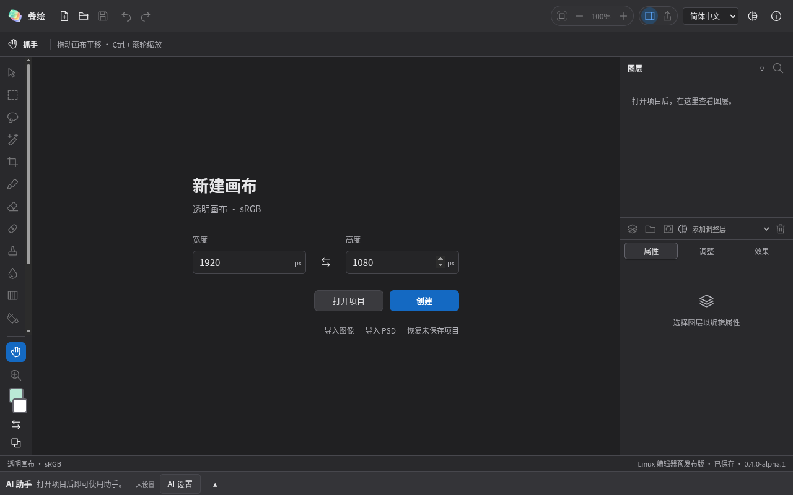

修改后：

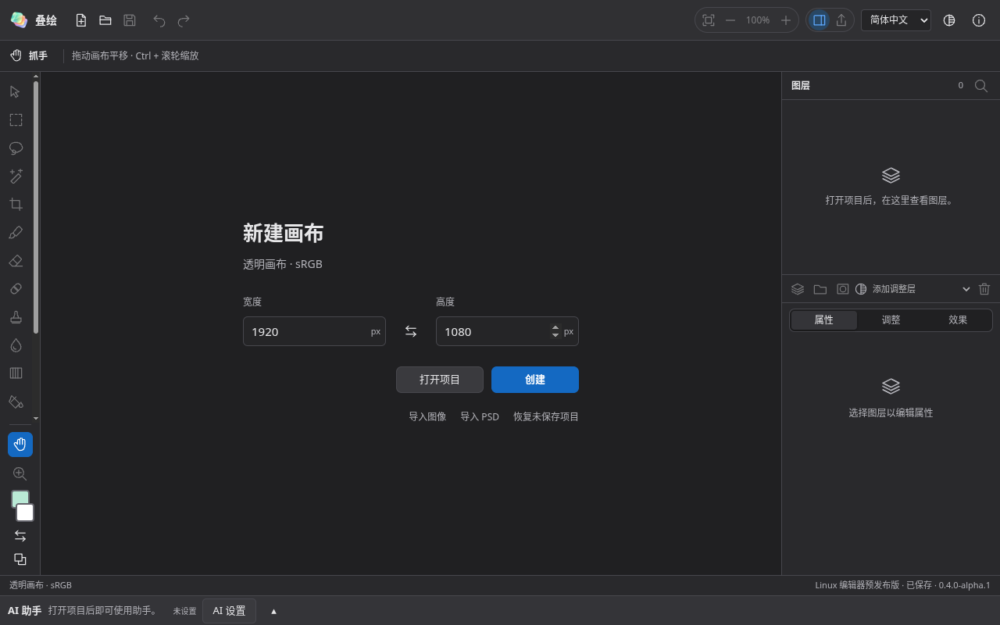

### 2 · 属性面板

修改前：

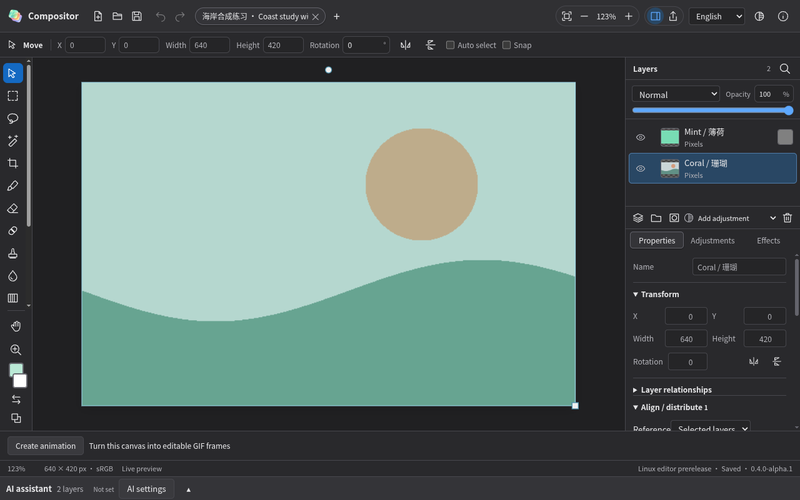

修改后：

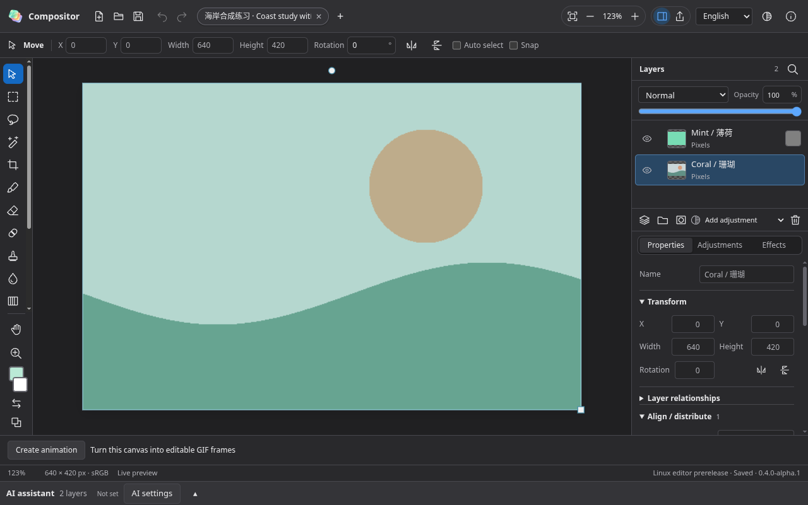

[浅色面板](desktop-ui-refinement-2026-10-29/02-inspector-light-after.png) · [属性区滚动与对齐控件](desktop-ui-refinement-2026-10-29/07-arrange-after.png)。

### 3 · 设置表单

修改前：

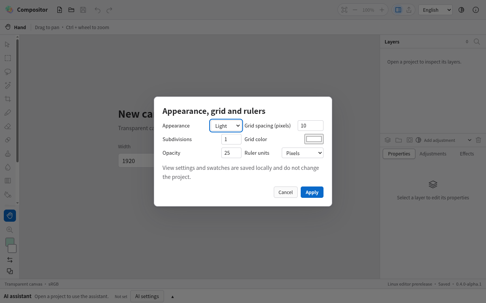

修改后：

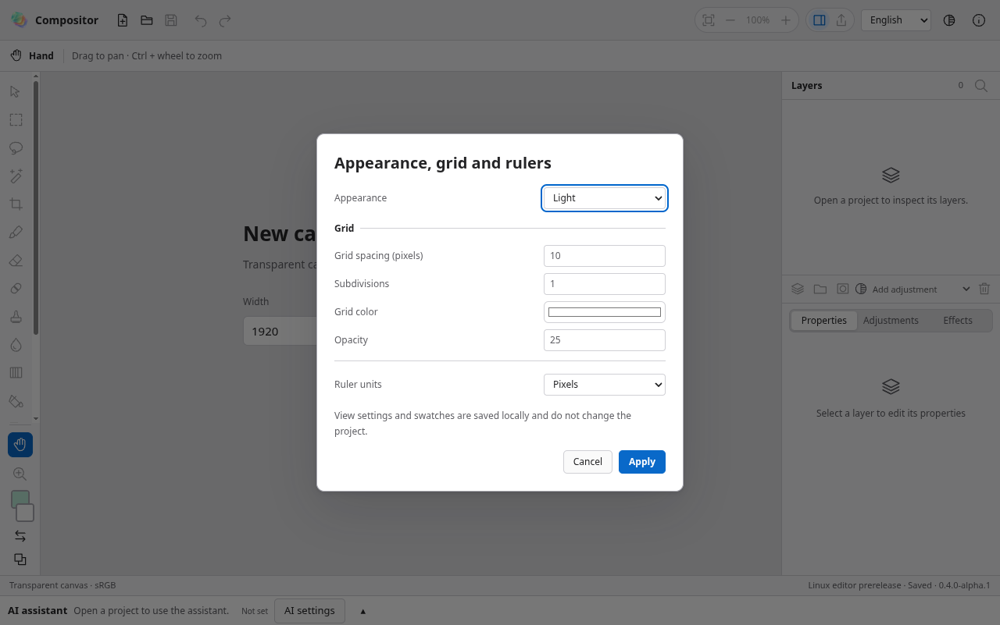

[中文深色小窗口设置](desktop-ui-refinement-2026-10-29/03-settings-chinese-after.png)。

### 4 · 紧凑窗口

修改前：

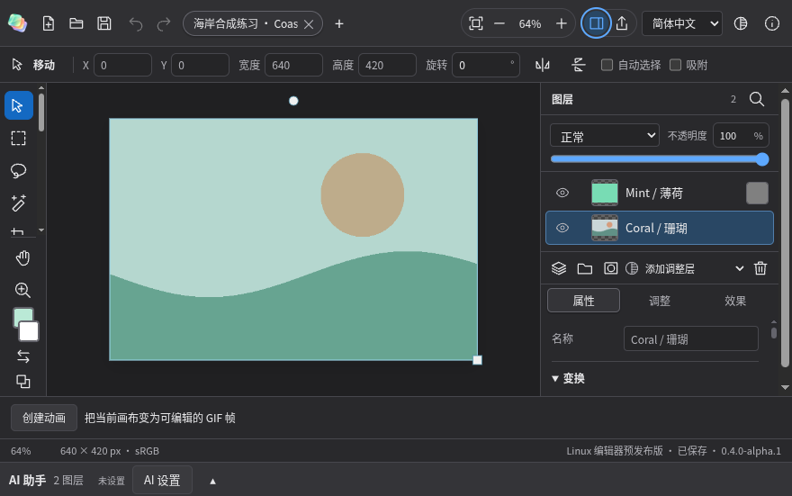

修改后：

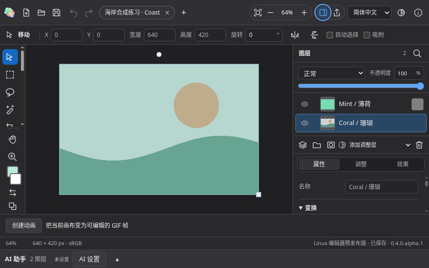

[普通紧凑窗口滚到属性底部，图层底栏仍可见](desktop-ui-refinement-2026-10-29/04-compact-footer-after.png)。

展开助手后的极矮工作区曾将属性区挤成 0 高度：

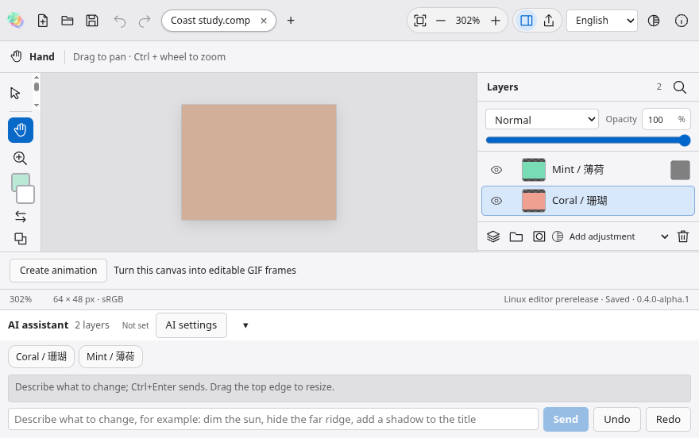

修复后可用真实鼠标滚动到属性底部；[侧栏顶部状态](desktop-ui-refinement-2026-10-29/08-short-top-after.png) 保留明显的滚动条：

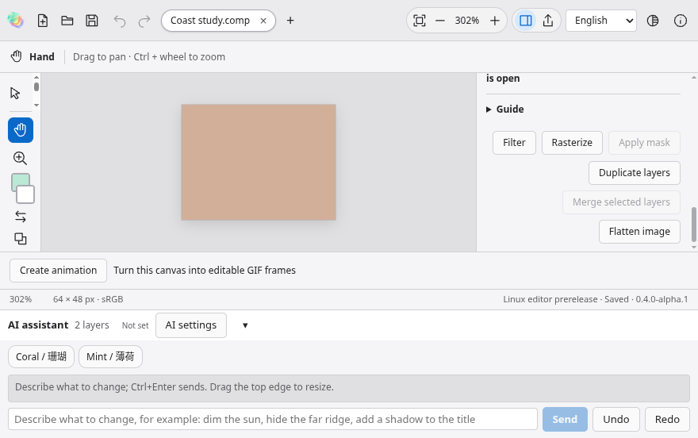

### 5 · 颜色控件焦点

修改前，前景色 input 已获得焦点，但色块外没有可见提示：

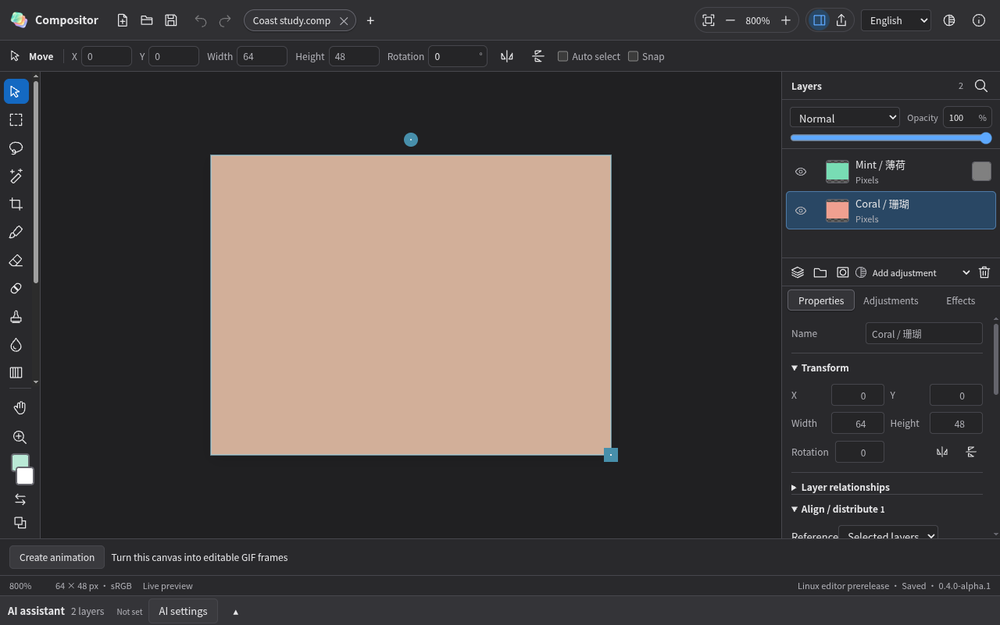

修改后：

### 6 · 文件拖入

修改前：

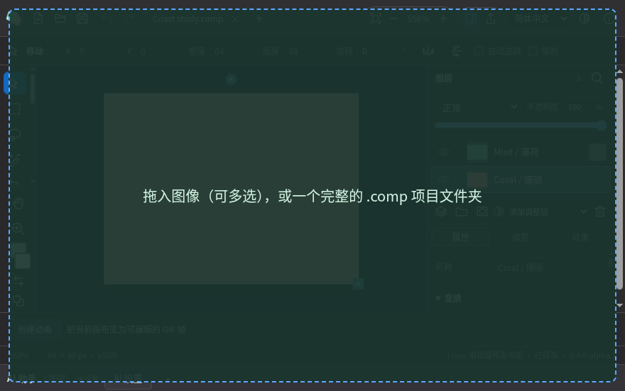

修改后：

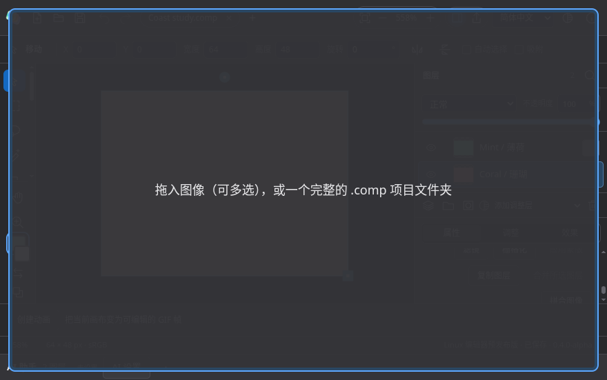

### 7 · 对齐与分布

图标调整前：

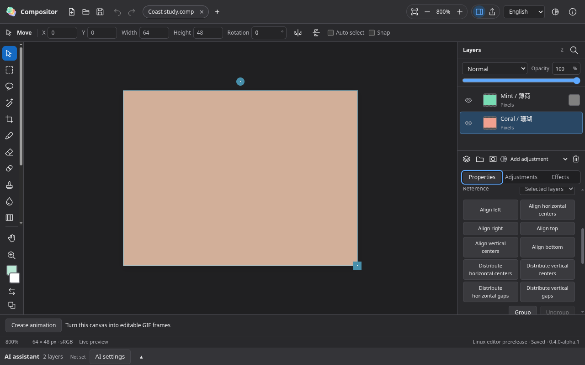

图标调整后，保留全部操作和原有顺序：

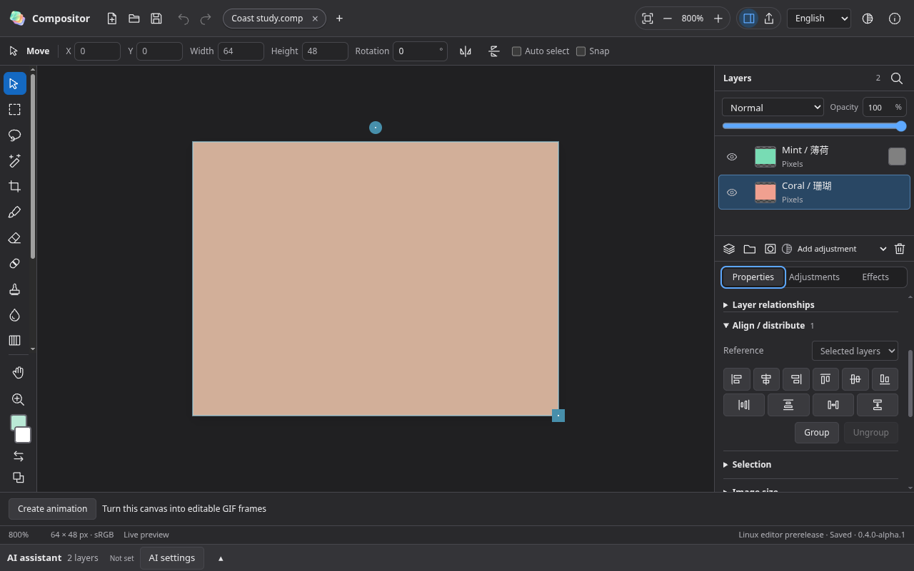

## 验证与隐私审查

基线新增的两个界面回归用例均失败，实际检测到输入框被挤压、透明颜色 input 缺失外部焦点提示、外侧栏溢出以及绿色拖入提示；原始失败日志与截图分开保留，未降低断言要求。补查助手展开的小窗口状态时，还在 `13c04d2` 复现了鼠标无法滚到属性区的问题（视口比例为 0）；Windows 云端同一候选也因属性区高度为 0 而失败：[40812201842](https://github.com/Pengjingyu1992/Compositor-ZH/actions/runs/40812201842)。修正采用短工作区的整侧栏滚动，保留原有“属性区高度至少 100 px”的断言，并增加真实鼠标滚动回归。最终应用本地外观／布局 4/4 与桌面边界 7/7 分别通过。对齐／分布、选区、蒙版、滤镜及撤销的九项专项在前一候选通过；最终完整覆盖以以下平台结果为准。类型检查、构建和 251 项单元测试通过。新用例另外验证了紧凑窗口底部属性控件、图层底栏及方向键标签切换。

源码审查通过：226 个 Windows/Linux 桌面文件、767 个双语键；201 个静态按钮声明和 80 个命令入口未发现隐式表单提交。静态清单不是按钮运行覆盖率。

最终本地应用 ASAR SHA-256：`1859f0af98d8e9f17fd234bc01af5dd00149a6fd15418327dd7639ff14c16eda`。[验证摘要](desktop-ui-refinement-2026-10-29/verification.json) 记录其 213 个条目、161 个文本文件扫描未发现匹配的私有路径／凭据模式，未包含测试目录、项目样本、源码映射、环境文件或仓库目录。新增文字和截图单独检查；20 张 PNG 仅含 IHDR／IDAT／IEND 块，没有文字或 EXIF 元数据；截图内容使用合成项目与隔离配置。此类模式检查不能证明不存在任何未知隐私风险。

完整平台验证使用最终应用提交 `59edcc7`：

| 平台 | 本轮工作流 | 完整结果 |
|---|---|---|
| Windows | [40813707029](https://github.com/Pengjingyu1992/Compositor-ZH/actions/runs/40813707029) | 成功：106 项 GUI 通过，3 项 Linux 专属跳过；NSIS/ZIP、独立读取、许可证、校验值与包隐私审查通过 |
| Linux | [40813706930](https://github.com/Pengjingyu1992/Compositor-ZH/actions/runs/40813706930) | 成功：109/109 GUI，无跳过；独立格式读取、提取后的 AppImage 启动器、AppImage/Deb/tar.gz、许可证、校验值与包隐私审查通过 |

首次候选 `dae990d` 的平台运行被后续提交自动取消；`13c04d2` 的 Windows 失败保留如上，其 Linux 运行被新提交取消。这些均不作为最终验收。原生 macOS 源码、工程、测试、设置和发行工作流均未修改。仅更新开发分支，未创建正式发行或替换全局 Latest。

真实 Windows/Linux 桌面的高 DPI、多屏、屏幕阅读器和系统颜色选择器仍需实机验收；云端截图及软件 GPU 检查不能替代这些结果。此次不作完整无障碍合规或所有 UI 状态无缺陷的承诺。
