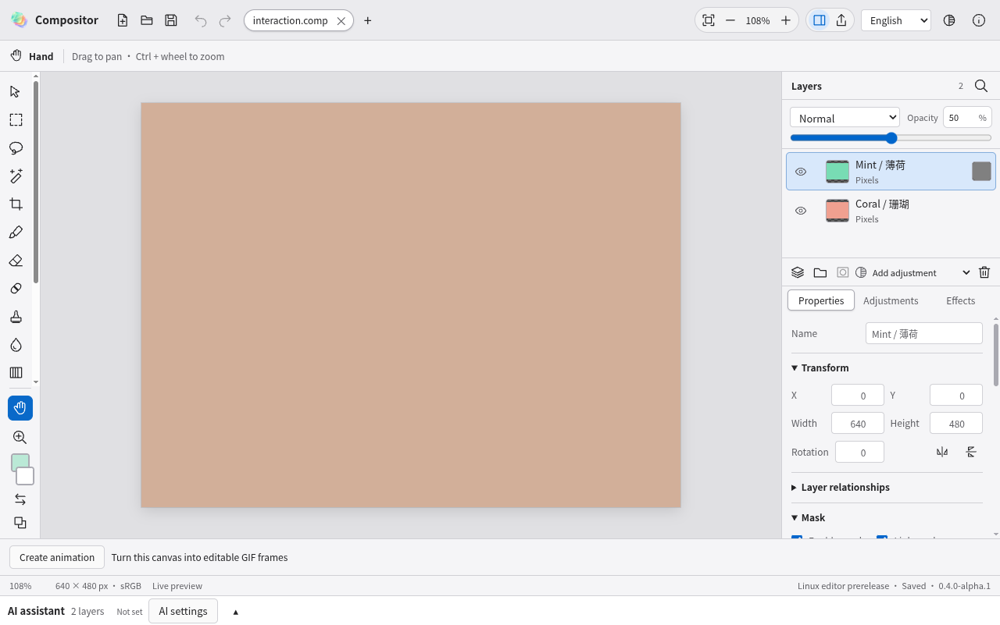
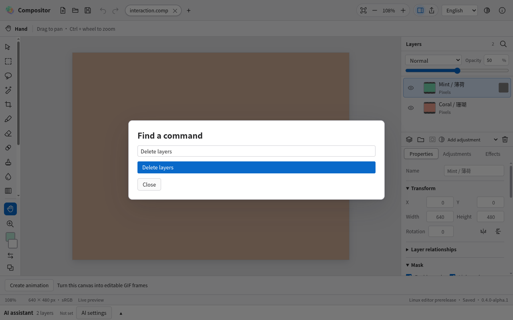
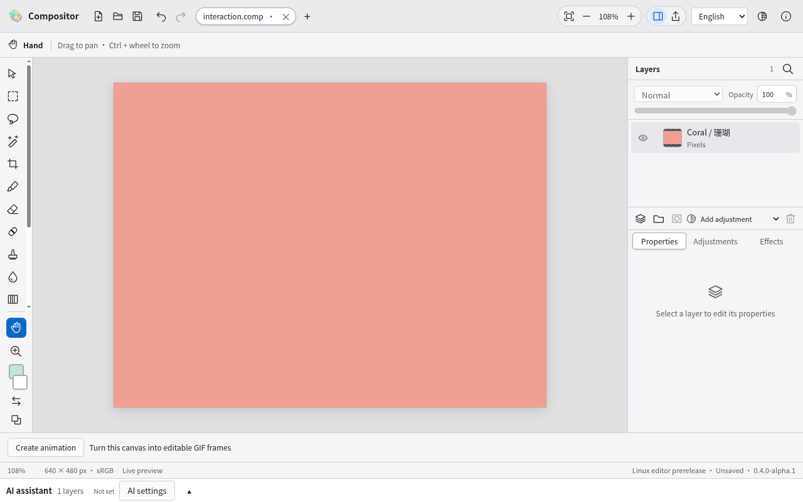
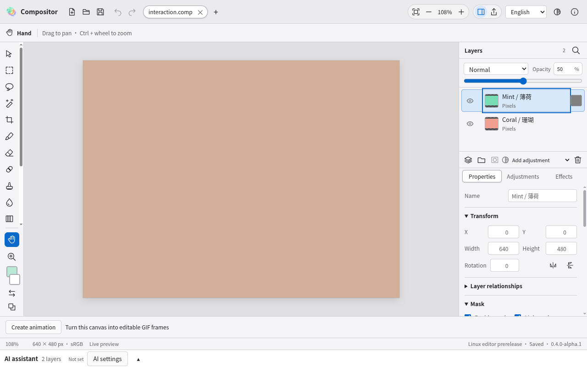
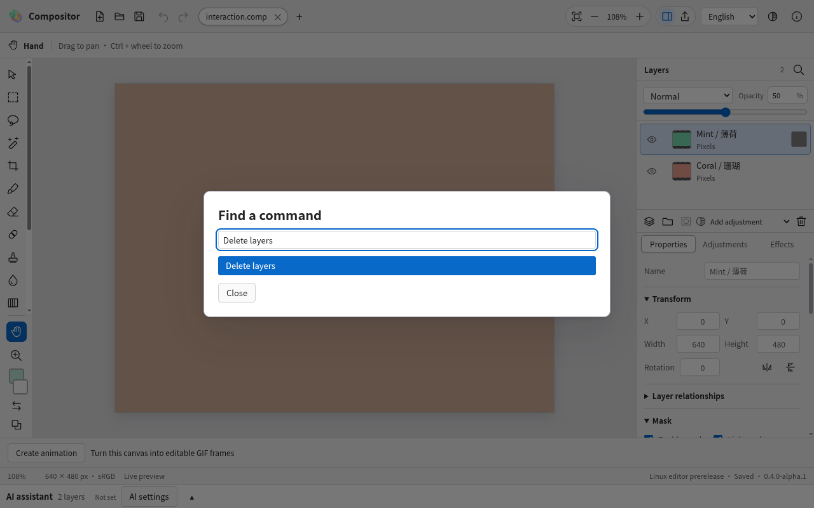
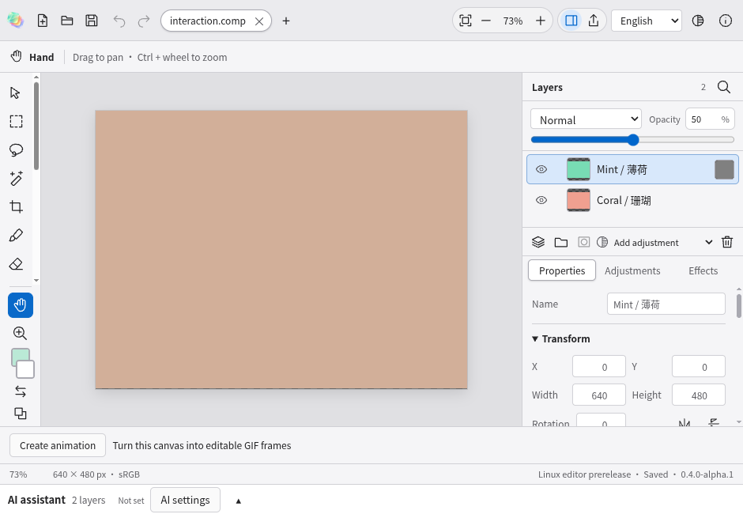
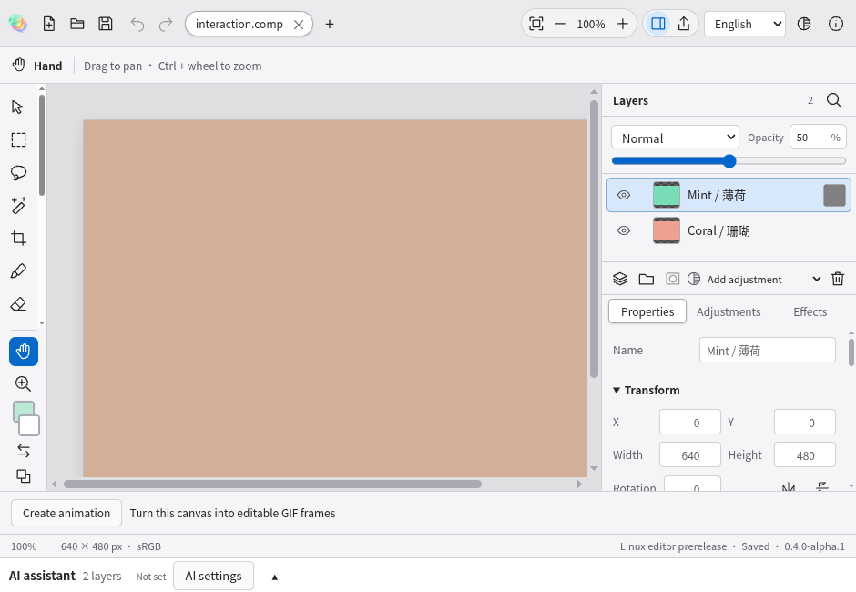
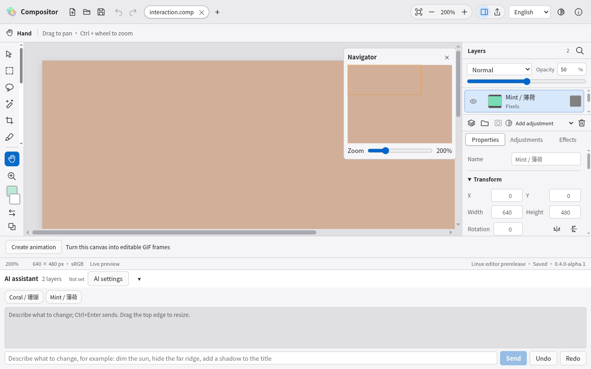
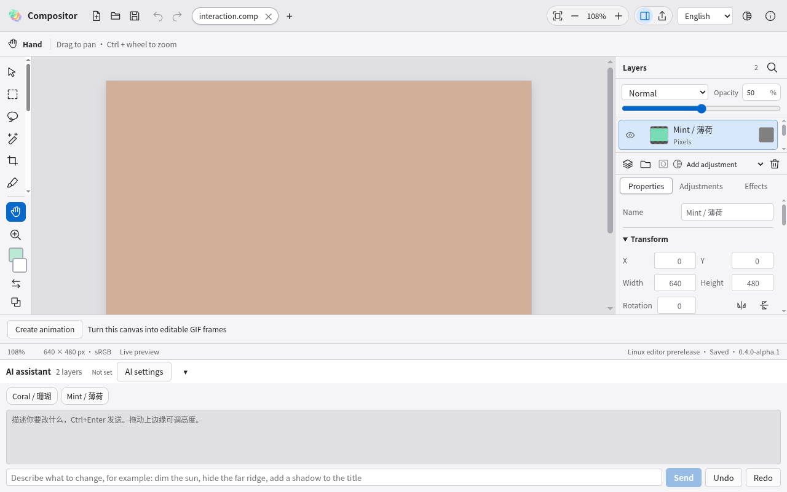
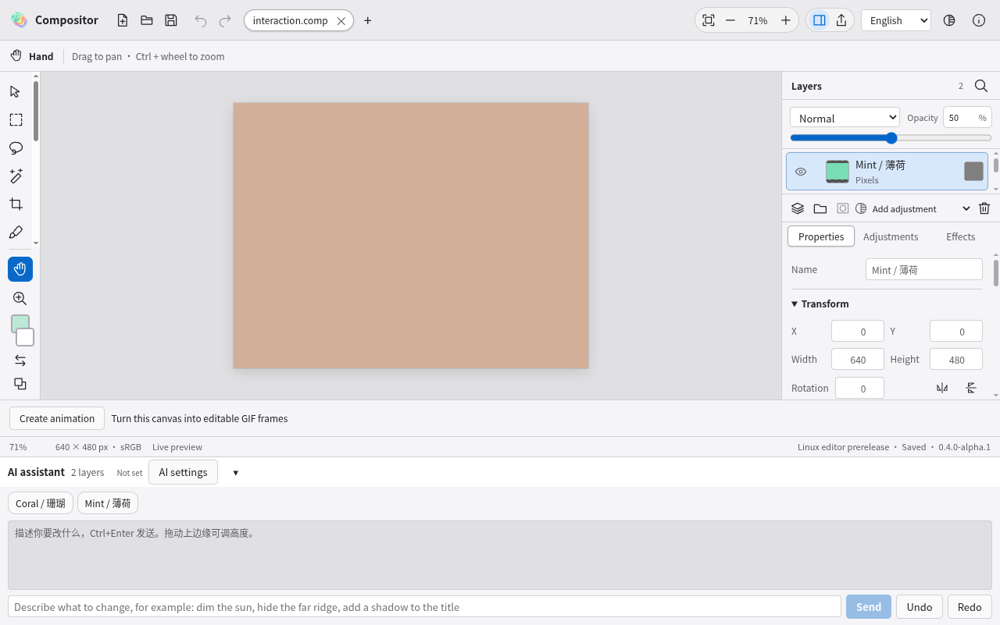

# Windows/Linux UI 与交互排查 · 2026-10-29

修复代码：`9969174`、`72082f9`、`fd995ec`，分支 `codex/desktop-macos-parity`。本轮检查现有编辑器的命令键盘路径、手动缩放、工作区布局、导航缩略图与语言切换；保留已经确定的 macOS 风格，不修改原生 macOS。

使用真实 Electron 应用、合成的两图层项目和隔离配置。以下截图均在本次排查现场捕获并逐张查看；以截图、实时 ARIA 状态和键盘／几何断言共同判断，不使用旧截图作为本轮证据。起始编辑界面正常：项目、画布、图层及选中态清楚，原有撤销与弹窗保护保持可用。

## 1. 命令窗口关闭 · 高影响，已修复

步骤：选中图层 → 打开命令查找 → 搜索 `Delete layers` → 聚焦 Close → 按 Enter。旧界面把弹窗中所有 Enter 都交给当前搜索结果，导致关闭操作实际删层，图层从 2 变为 1，项目出现修改标记。现在按钮使用自己的原生激活行为，只有搜索输入框中的 Enter 执行高亮命令；关闭后仍为两层，没有新增撤销记录，并恢复原焦点。

| 旧版按关闭后的结果 | 修复后关闭的结果 |
|---|---|
|  |  |

## 2. 命令搜索文字编辑 · 已修复

步骤：搜索 `Delete layers` → 在输入框按 Home，再按 End。旧界面截获 Home/End 来切换结果，Home 后光标仍在索引 13；现在保留原生文字编辑，Home 到 0、End 到 13，方向上下键继续浏览可用命令，IME 合成与 Ctrl/Meta/Alt 修饰键保持隔离。无可执行项时不再把 `aria-activedescendant` 指向禁用项。

| 旧搜索状态 | 修复后搜索状态 |
|---|---|
|  |  |

截图展示输入状态；光标位置由 DOM 断言验证，不能仅从隐藏文本光标的截图判断。

## 3. 手动缩放与窗口／项目切换 · 已修复

步骤：选择 100% → 把窗口从 1280 × 800 调整为 940 × 650。旧界面自动改为 73%；现在手动比例保持 100%，并在新建另一标签页、切回和再次调整窗口后继续保留。手动比例可以产生滚动区域；点击“适合窗口”才进入自动适配状态。缩放模式仅在当前工作区各标签中记录，不写入项目文件。

| 旧版被自动改为 73% | 修复后保留 100% |
|---|---|
|  |  |

## 4. 导航缩略图与布局变化 · 已修复

步骤：打开 Navigator，设为 200% → 展开 AI 面板。画布可见区域缩小后，旧缩略图框仍保持原高度。现在观察实际工作区尺寸变化，更新导航框，并在范围与中心计算中扣除滚动条。新断言同时核对导航框变小、缩放仍为 200%，以及框的高度与实际可见画布几何一致（误差小于 1.1 px）。

| 旧版显示过大的可见框 | 修复后与可见区域同步 |
|---|---|
|  |  |

## 5. 适合窗口与 AI 面板展开 · 已修复

步骤：点击“适合窗口” → 展开 AI 面板。旧界面仍为 108%，画布被工作区截断；现在自动重算为当前可用尺寸（本例为 71%），完整画布可见。手动比例与自动适配分别处理；按帧合并布局更新，并在卸载时释放 ResizeObserver 和待执行帧。

| 旧版适配结果被布局变化破坏 | 修复后重新适配 |
|---|---|
|  |  |

## 6. 语言切换后的 AI 入门提示 · 已修复

步骤：把界面从中文切换为英文 → 展开 AI 面板 → 再切中文与英文。截图中标题、输入提示和按钮已是英文，但入门说明仍是启动时保存的中文。固定的应用说明现在直接使用当前语言的响应式消息，不再作为历史对话快照保存；真正的用户输入和模型回复保持原始内容。新增检查在 `72082f9` 实际包上复现中文残留，最终包验证双向切换并保持项目未修改；最终新增 7 个 UI 场景已单独通过 7/7。

| 修复前混合语言 | 修复后当前语言一致 |
|---|---|
|  |  |

## 验证与范围

新增的 5 项在旧应用上全部复现失败。第一版修复的 16/16 定向 GUI 通过，但完整回归发现了适配缩放的时序回归：本机 94/95 通过，[Linux 首轮](https://github.com/Pengjingyu1992/Compositor-ZH/actions/runs/40753713760) 94/95 通过，[Windows 首轮](https://github.com/Pengjingyu1992/Compositor-ZH/actions/runs/40753714240) 90 项通过、2 项失败、3 项 Linux 专属检查跳过。失败结果保留，不能将定向通过视为完整通过。

原因是旧的高倍缩放占用了滚动条宽度，“适合窗口”首次算出 105%，滚动条消失后 ResizeObserver 又改为 108%；指针测量之间的比例变化使应在 144 px 的参考线落到约 146.82／147.87 px。`72082f9` 改用稳定的工作区完整盒尺寸计算适配，导航框继续使用扣除滚动条后的可见区域。新增第 6 项检查捕获首次缩放并验证后续帧不再改变；该检查在第一版修复包上失败，最终修复后通过。原有 144 px 标尺坐标断言保持不变。

Windows 首轮另一项失败是印刷预览图片未在默认 5 秒内出现，现有摘要不能证明它的性能根因。测试改为先在已有的 30 秒编解码任务预算内等待操作完成，再检查无错误、图片可见，以及所有格式的尺寸、元数据和输出字节；没有修改编解码算法或宣称解决底层性能问题。缩放修正候选 `72082f9` 的定向检查含新增 6 项和原有命令／导航／多项目／弹窗／图像输出，共 18/18 通过；随后根据截图补修第 6 类语言问题，最终 `fd995ec` 再以新增 7 个场景和完整回归验收。

中间候选 `72082f9` 的两次云端运行因 `fd995ec` 推送而被工作流自动取消：[Windows](https://github.com/Pengjingyu1992/Compositor-ZH/actions/runs/40757549025) 为 73 项通过、1 项中断、3 项跳过、19 项未运行；[Linux](https://github.com/Pengjingyu1992/Compositor-ZH/actions/runs/40757549260) 没有完整 GUI 汇总。这两次不计作最终通过。

缩放修正候选 `72082f9` 的本机完整检查另已通过 96/96（无失败、跳过或重试），其应用 ASAR SHA-256 为 `c3ba0bb7e5f0be71b409b453bbc92cf7f1db65be585fe748942ccb1ce0d99687`；最终 `fd995ec` 的结果另列如下。

251 项单元、TypeScript、独立 PSD／GIF／EPS／PNG/JPEG/TIFF/WebP/AVIF/PDF／ICC／CMYK 读取通过。源码审查覆盖 222 个桌面文件和 766 个双语键；最终应用 ASAR 213 个条目、161 个文本文件中，私有路径或凭据模式匹配为 0。

| 最终检查 | 结果 |
|---|---|
| 本机最终包检查 | 新增 7/7 定向场景通过；完整运行已完成 61 项、0 项记录失败，随后环境重启中断，36 项未完成，不记为完整通过 |
| Windows 云端 | [40758606058](https://github.com/Pengjingyu1992/Compositor-ZH/actions/runs/40758606058)：成功，94 项 GUI 通过，3 项 Linux 专属检查跳过；安装器／ZIP、许可证与包隐私审查通过 |
| Linux 云端 | [40758606128](https://github.com/Pengjingyu1992/Compositor-ZH/actions/runs/40758606128)：成功，97/97 GUI；AppImage 启动器、三种安装包、许可证与包隐私审查通过 |

最终验收采用 `fd995ec` 的两平台完整云端运行；本机中断的原始日志单独保留，未产生完整结果 JSON，没有将其与定向结果合并为一轮成功。

最终本机应用包的 ASAR SHA-256：`79fcd80f08df5709712b549db41264e2d8700be4c3a3a0975e332e9d029997ce`。失败报告与修复后的报告分别保存。除了上述印刷预览完成状态的等待调整，保留原有内容与坐标断言；截图用于呈现现场，交互结果另由断言验证。

成对截图来自 Linux 的英文浅色界面；共同界面的双主题、中文输入字段和原生菜单路径继续由完整回归检查。截图和 DOM 键盘检查不代表完整无障碍合规；实际读屏、真实中文输入法、压感设备、硬件 GPU 和高 DPI 仍需各平台实机验收。此前记录的本机偶发 WebGL／超时异常仍保留跟踪，不因本轮 UI 修复而宣称解决。

本轮未更改图像算法、文件格式、安装身份或发行通道，没有发布新正式版或改动 macOS／全局 Latest。代码和 CI 安装包均属于开发分支。
